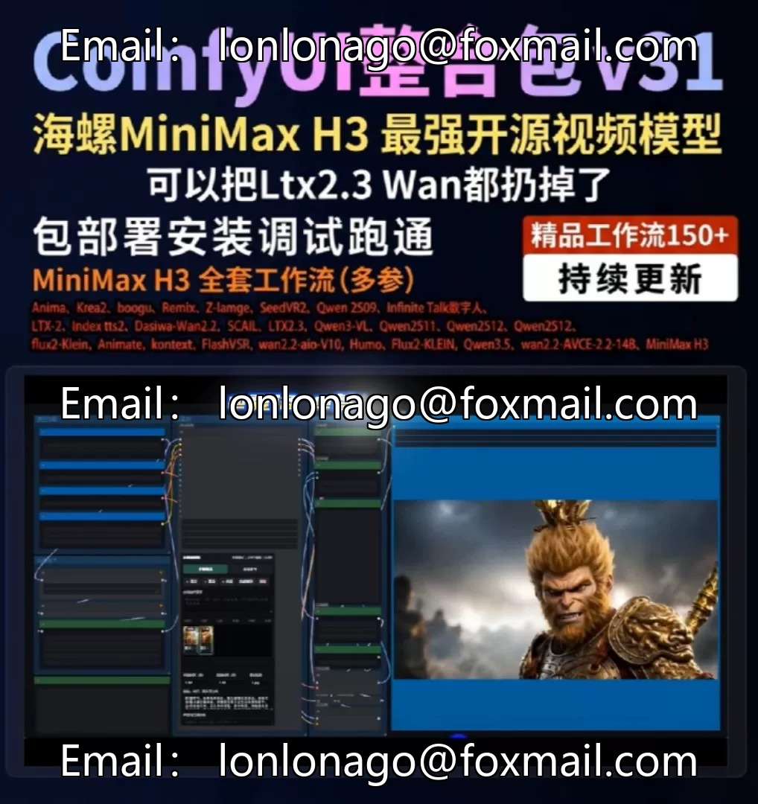

# Packaged to pass MiniMax H3 full suite Comfyui V33 20

## Body

Packaged and tested for full functionality of MiniMax H3, Comfyui V33 2026 Ultimate Edition package deployment, installation, and debugging. Local deployment one-click integration package. Unzip and use immediately. No need to deploy computer environment. Supports the full series of N cards. 50 series 40 series 30 series 20 series! Special support for Tesla Tesla V100 graphics card.

August Update Content (Continuous updates...
101. MiniMax H3 - Speaking and Singing Duo (4-step acceleration version)
102. MiniMax H3 - Speaking and Singing Solo (4-step acceleration version)
103. MinimaxH3: End-to-End Video with Frame Generation (4-step acceleration version)
104. minimax-Batched Manga Series 20-Grid - Directly output 1-minute video V3
105. Minimax CS-H3 - Multi-Grid - Multi-reference director's workflow
106. Minimax H3 - Multi-Image Comprehensive Two-Color - V2

0-1-Original - LTX2.3 - Distilled Version - MSR-V2+ Comprehensive Reference
0-2-Revised - LTX2.3 - Distilled Version - MSR-V2 - Multi-Role Comprehensive Reference
0-3-Theater: LTX2.3 - MSR-V2 - Upgrading Edition - Comprehensive Reference - Custom Audio
0-4-Theater: LTX2.3 - MSR-V2 - Upgrading Edition - Comprehensive Reference - Custom Audio
0-5-Multi-Grid High-Definition Magnification!
Essential Features for Open Source Short Plays
Extra
86, MiniMax H3 - (Comprehensive Reference) Multi-Image Reference (Sage Acceleration Version)
87, minimax-H3 - Mass Production of Romance Plays with 20 Grids, Directly Outputting a 1-minute Video (Sage Acceleration Version)

88. MiniMax-H3_i2v-Sage Acceleration Version
89. MiniMax-H3_i2v-Start and End Frames (Sage Acceleration Version)
90. MiniMax-H3_i2v-Textually Generated Video (Sage Acceleration Version)
Nail
83. Animate - Video Clothing
84. Animate - Video Head
85. Ltx2.3 - Remove Subtitles for High Definition
81. Krea2 - Full Series Workflow
82. boogu - Full Series Workflow
75. Scal2 - Action Transfer - Long Battery Life Edition (One of the strongest open-source options available) (Case Study)
76. Scal2 - Video Replica - Long Battery Life Edition (One of the strongest open-source options available) (Case Study)

77. Scail2-Community Official Stream (Refer to multiple sources) - Person Consistency (with case studies
78. Anima-Anime Models - Text-to-Image Workflow
79. Anima-Anime Models - Image-to-Image Workflow
80. Bernini-All-in-One Video Editor - Single Image Reference Workflow
81. Bernini-All-in-One Video Editor - Multi-Image Reference Workflow
Red Flag
1. LTX2.3-Distilled Edition - Director's Table V3.0 Version
2. LTX2.3-GGUF - Director's Table V3.0 Version
3. LTX2.3-dev-8G Graphics Card - Text-to-Video (Image-to-Video
4. LTX-2.3 Distilled Edition V3 Singularity (Image-to-Video

5. LTX-2.3 GGUF Singularity (Animated Video)
6. LTX2.3-Distilled Edition - Monologue and Duologue Audio-Visual Sync with "Opening Monologue" Optimized Version
7. LTX2.3-GGUF-Monologue and Duologue Audio-Visual Sync with "Opening Monologue" Optimized Version
8. LTX2.3-Distilled Edition - 20x20 and 4x4 grids (Manga/Anime) Direct Optimization Version
9. LTX2.3-GGUF-20x20 and 4x4 grids (Manga/Anime) Direct Optimization Version
10. LTX-2.3 Distilled Edition V3 Singularity (Start and End Frames)
11. LTX-2.3 GGUF Singularity (Start and End Frames)

12. LTX2.3-dev-Video Generation (Start and End Frames)
13. LTX2.3-dev-Digital Human Audio Driven Video Generation
14. Flux2-klein-Super[Change Clothing]Details Preservation
15. Qwen+Flux2-[Print Stitching]& Direct Outline Effect
16. i2-Text to Picture & Picture to Picture Direct 4K
17. LTX2.3 Full Optimization Version - DEV Version (8GB Graphics Card Version)
18. One-Click Story Scenery Qwen3.5-Flux2-klein
19. Qwen3.5 Language Big Model (Complete Workflow)
20. Wan2.2 Animate Action Transfer (Version 8)

21. InfiniteTalk video with lip sync - dual model super real
22. (E-commerce Specific) Animate - product action transfer (items remain unchanged)
23. E-commerce HOMOSTYLE & Audio E-commerce Product Sales Digital Humans
24. Flux2-Klein 9B Action Transfer
25. Flux2-Klein Standard Stream for Text-to-Image Generation
26. Flux2-Klein Image Expansion Stream
27. Flux2-Klein Image Generation and Washing Stream
28. Flux2-Klein Local Redrawn Stream
29. Flux2-Klein 360 Degree Multi-angle Transformation
30. Flux2-Klein Single, Multiple Images Editing

31. Ultimate Edition of Flux-2-Klein Image Magnification for Enhanced Details
32. Flux-2-Klein Three-View Images of Figures
33. Flux2-Klein Image Greenery Generation Enhancement
34. Flux2-Klein Optional Migration
35. Flux2-Klein Image Magnification for Enhanced Details
36. Flux2-Klein 9B Image Greening Workflow
37. Flux2-Klein Perfection of Everything
38. Flux2-Klein 9B Image Restoration + SeedVR2 High-Definition Magnification
39. Flux2-Klein 9B All-Purpose Migration

40. Flux2-klein Architectural White Film to 3D Rendering, Design Coloring, and 3D Plan View
41. Custom Edition - Commercial Line Drawings Output
42. Video-specific - Multi-person Action Transfer with 12-16GB Graphics Card
43. (Superior) - Image Transfer for Everything, No Change in Background
44. Secondary Creative Exclusive Qwen Edit2509 Direct Cutting of Multi-angle Scenes
45. Secondary Creative Exclusive Qwen - The Ultimate Animated to Real Person Conversion
46. Secondary Creative Exclusive OldX Ultimate Version for Figure Transfer
47. Wan2.2 - Animate Pro
48. Wan2.2 - REmix-Q4 Start and End Frames
49. Wan2.2 - REmix-Q4 Textual to Video

50. Wan2.2-REmix-Q4 Vision
51. Wan2.2-REmix-Q4 Video
52. Z-Image Vision - Back-propagation
53. Z-Image Text - Vision
54. Z-Image Turbo - Pose Control Vision
55. Z-Image LORA - 2K Direct Out of 4K Vision
56. zimage - [Remove AI Feel and Add Details] High Definition Restoration Direct Output 4K
57. New King!
2509-Perfect Transfer of Models in Multi-Images
58. Qwen3-VL Video Back-propagation - Prompt Words for Live Video
59. Qwen3-VL First and Last Frame Back-propagation Prompt Words
60. Qwen3-VL Image Back-propagation - Prompt Words for Live Video

61. Qwen3-vl image inversion - live picture prompt words
62. indexTTS2: Strong voice cloning support for multiple people, 10-person conversations
63. SeedVR2 video high-definition repair and enlargement v2
64. SeedVR2 image high-definition enlargement
65. SP506-video frame interpolation (GIMM-VFI
66. Quantized I2V-InfiniteTalk digital person - GGUF
67. Qwen2512 text to picture - lora light and shadow (full update in progress)
68. New version Fill - remove, enlarge, redraw in one
69. Photo studio level cosplay comic to real person - effect is very strong
70. DaSiWa-WAN2.2 first and last frame video - cartoon model dedicated for animation

71. DaSiWa-WAN2.2 Graphic Video Streaming - Anime-Specific Model
72. Qwen-Edit-2509 - Advanced High-Definition Repair & Photographic Texture Transformation & Relighting
73. Qwen2511 - Graphic Production
74. Qwen2509 Person Consistency - Superior Clothing Changes

▶The current base package size is 167g, divided into split versions and integrated versions (510G). The split version allows for optional installation of models and workflows.
On this base package, one can expand on other external workflows (requires some basic knowledge) and need to debug them themselves.
▶Supports remote deployment installation and debugging (remote deployment: includes the installation of the integrated package.
▶Updates are made every 3-5 days, including selected workflows, which include the models and nodes (the update content includes installation tutorials that need to be installed by oneself.
▶This package contains commands created by myself, supporting one-click installation of node dependencies, one-click updating of comfyui to the latest version, and running it with a double click!
Very convenient and fast

▶All workflows mentioned above have been fully implemented on the 4060ti with 16G VRAM and 32G RAM computer end, and can be applied in practice.

Note: No instruction is provided; however, there are tutorials available. The content includes deployment and debugging (including all workflows that have been successfully implemented). As for creating what kind of work, it is up to the individual to make their own decisions without being taught.

▶ Includes a model overview
Bernini, Anima, Scai2, VACE, LTX2.3, Remix, Z-Iamge, SeedVR2, Qwen 2509, Qwen2511, Qwen2512, Infinite Talk digital human, LTX-2, Index tts2, Wan2.2-Dasiwa anime specific model, SCAIL model, Qwen3-VL reasoning, flux2-Klein, Anima model, HUMO model, i-2
All workflows mentioned above have been fully implemented on the computer with 4060ti 16G VRAM and 32G RAM, and can be applied in practice.

▶All workflows have corresponding basic operation tutorials! Feel free to use them! [Buy with a verified account to prevent buying pirated versions]

▶ Package deployment! Installation! Debugging! Also, solve all your computer issues.

▶The package includes two versions
1. The integrated version is 560G in size.
2. The split version (selectable models and workflow downloads)

▶ Local Deployment Basic Requirements
20 series or above graphics card, more than 12GB of memory, 32GB of memory.

Note: MAC is not supported! A-cards are not supported.
Virtual materials, please do not bother with free downloads! The total package is about 510G, through  and Kuaike.

## Images

## Payment

Here is a pay link on Stripe ( https://buy.stripe.com/3cs8yP7sY87d0vu9AB ). Please contact me lonlonago@foxmail.com after funding $89, and I will send you a complete data files , thank you!

